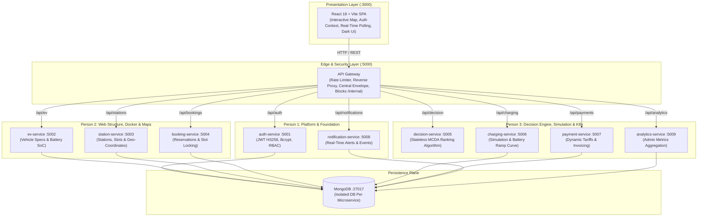

# ⚡ Autonomous EV Charging System

> **Distributed Multi-Service Platform for Autonomous EV Routing, Real-Time Slot Reservation, Simulated Fast Charging & Dynamic Tariffs**

[](https://nodejs.org)
[](https://expressjs.com)
[](https://mongodb.com)
[](https://docker.com)
[](https://hub.docker.com/r/axar9408/autonomous-ev-charging-system/tags)
[](infra/kubernetes/)
[](frontend/)

---

## 📌 Executive Summary

The **Autonomous EV Charging System** is an enterprise-grade microservices platform designed to solve urban EV charging bottlenecks. It connects electric vehicles with charging stations through an autonomous multi-factor recommendation engine that balances distance, charging speeds, dynamic tariffs, queue length, and vehicle State of Charge (SoC).

### Key Highlights
- **11 Microservices + React SPA**: Cleanly decoupled domain boundaries with isolated MongoDB databases per service.
- **Autonomous Decision Engine**: Deterministic multi-criteria decision algorithm (MCDA) with priority boosting for depleted batteries.
- **Interactive Live Map & Real-Time Tracking**: GPS fallback, simulated live EV charging curves (`SIM_SPEEDUP`), and interactive routing.
- **Unified Docker Hub Distribution**: All 11 microservices packaged under a single repository roof: [`axar9408/autonomous-ev-charging-system`](https://hub.docker.com/r/axar9408/autonomous-ev-charging-system/tags).
- **Dual Security Model**: Public routes protected by JWT (`HS256`); internal service-to-service calls secured via `x-internal-key`.
- **Zero-Interference Team Ownership**: Structured 3-person team distribution (Platform, Core Domain, Intelligence).
- **Production-Ready Orchestration**: Docker Compose, Docker Hub instant pull, and Kubernetes manifests with HPA auto-scaling.

---

## 🏛️ System Architecture



---

## 👥 3-Person Team Division of Work

| Team Member | Role & Focus | Key Deliverables & Responsibilities |
|---|---|---|
| **Person 1** | **Platform & Foundation** *(Beginner-Friendly)* | • `auth-service` (User registration, login, JWT HS256, Bcrypt)<br>• `notification-service` (User alerts, station updates)<br>• MongoDB configuration & base environment setup |
| **Person 2** | **Website Structure, Docker & Interactive Map** | • React 18 + Vite Frontend SPA (Dashboard, dark UI, responsive styling)<br>• Interactive Leaflet/OpenStreetMap integration with GPS routing<br>• `ev-service`, `station-service`, `booking-service`<br>• Docker Hub publishing & Docker Compose configuration |
| **Person 3** | **Decision Intelligence, Simulation & Kubernetes** | • `decision-service` (Multi-criteria ranking: distance, price, power, queue, SoC)<br>• `charging-service` (Simulated battery charging curves & ramp-up)<br>• `payment-service` & `analytics-service`<br>• Kubernetes manifests (Deployments, Services, ConfigMaps, Secrets, HPA) |

*(See [PRESENTATION_MASTER_GUIDE.md](PRESENTATION_MASTER_GUIDE.md) for full viva talking points and individual Q&A prep).*

---

## 🧭 Service Directory & Ports

| Service | Directory | Port | Database | Description |
|---|---|---|---|---|
| **frontend** | `frontend/` | **3000** | *None* | React 18 + Vite SPA, Leaflet map, GPS routing |
| **api-gateway** | `services/api-gateway/` | **5000** | *None* | Reverse proxy, rate limiting, route guard |
| **auth-service** | `services/auth-service/` | **5001** | `auth_db` | User auth, roles (`SYSTEM_ADMIN`, `USER`), JWT |
| **ev-service** | `services/ev-service/` | **5002** | `ev_db` | Vehicle telemetry, SoC, battery capacity |
| **station-service** | `services/station-service/` | **5003** | `station_db` | Station registry, slot state (`FREE\|BOOKED\|CHARGING`) |
| **booking-service** | `services/booking-service/` | **5004** | `booking_db` | Slot reservations, queue management, cancellation |
| **decision-service** | `services/decision-service/` | **5005** | *None* | Autonomous multi-criteria station recommendation |
| **charging-service** | `services/charging-service/` | **5006** | `charging_db` | Live charging session simulation with speedup |
| **payment-service** | `services/payment-service/` | **5007** | `payment_db` | Invoice computation (`energyKwh * tariff`), checkout |
| **notification-service** | `services/notification-service/` | **5008** | `notification_db`| In-app notification logs and user alerts |
| **analytics-service** | `services/analytics-service/` | **5009** | `analytics_db` | System revenue, energy consumption, and fleet analytics |

---

## 🔑 Demo Login Credentials

Pre-seeded accounts ready for immediate demonstration:

| Role | Email | Password | Access Privileges |
|---|---|---|---|
| **System Admin** | `admin@ev.com` | `Admin@123` | Full access to Admin Dashboard, Analytics, Fleet, Stations |
| **EV Driver / User** | `user@ev.com` | `User@123` | Route planner, slot reservation, charging simulator, payments |

---

## 🚀 Running the System

### Option 1: Instant Run from Docker Hub (Fastest — No Build Required)

All 11 microservices are pre-built and published to Docker Hub under [`axar9408/autonomous-ev-charging-system`](https://hub.docker.com/r/axar9408/autonomous-ev-charging-system/tags).

```bash
# Pull and start all 11 microservices + MongoDB with one command:
docker compose -f docker-compose.hub.yml up -d

# Check running status:
docker compose -f docker-compose.hub.yml ps

# Open in browser:
# http://localhost:3000
```

To stop:
```bash
docker compose -f docker-compose.hub.yml down
```

---

### Option 2: Local Development Build (Docker Compose)

```bash
# 1. Clone the repository
git clone https://github.com/classaxar/Autonomous-EV-Charging-System.git
cd Autonomous-EV-Charging-System

# 2. Setup environment variables
cp .env.example .env

# 3. Build images locally and launch
docker compose up -d --build

# 4. View logs or check status
docker compose ps
docker compose logs -f api-gateway
```

---

### Option 3: Production Kubernetes Deployment (`infra/kubernetes/`)

Deploy to any Kubernetes cluster (Minikube, Kind, or Cloud K8s):

```bash
# 1. Start Minikube & enable metrics-server
minikube start --cpus=4 --memory=8192
minikube addons enable metrics-server

# 2. Deploy all manifests in order
kubectl apply -f infra/kubernetes/namespace.yaml
kubectl apply -f infra/kubernetes/configmap.yaml
kubectl apply -f infra/kubernetes/secret.yaml
kubectl apply -f infra/kubernetes/mongodb.yaml
kubectl apply -f infra/kubernetes/auth-service.yaml
kubectl apply -f infra/kubernetes/ev-service.yaml
kubectl apply -f infra/kubernetes/station-service.yaml
kubectl apply -f infra/kubernetes/booking-service.yaml
kubectl apply -f infra/kubernetes/decision-service.yaml
kubectl apply -f infra/kubernetes/charging-service.yaml
kubectl apply -f infra/kubernetes/payment-service.yaml
kubectl apply -f infra/kubernetes/notification-service.yaml
kubectl apply -f infra/kubernetes/analytics-service.yaml
kubectl apply -f infra/kubernetes/api-gateway.yaml
kubectl apply -f infra/kubernetes/frontend.yaml
kubectl apply -f infra/kubernetes/ingress.yaml
kubectl apply -f infra/kubernetes/hpa.yaml

# 3. Watch pods transition to Running / Ready
kubectl get pods -n ev-system -w

# 4. Access Frontend
minikube service frontend -n ev-system
```

*(See [scripts/k8s-demo.md](scripts/k8s-demo.md) for automated chaos testing, pod scaling, and recovery demos).*

---

## 🐳 Docker Hub Unified Repository

All 11 microservices are hosted under one unified repository:
👉 **[https://hub.docker.com/r/axar9408/autonomous-ev-charging-system/tags](https://hub.docker.com/r/axar9408/autonomous-ev-charging-system/tags)**

| Service | Tagged Image in Unified Repo |
|---|---|
| **frontend** | `axar9408/autonomous-ev-charging-system:frontend` |
| **api-gateway** | `axar9408/autonomous-ev-charging-system:api-gateway` |
| **auth-service** | `axar9408/autonomous-ev-charging-system:auth-service` |
| **ev-service** | `axar9408/autonomous-ev-charging-system:ev-service` |
| **station-service** | `axar9408/autonomous-ev-charging-system:station-service` |
| **booking-service** | `axar9408/autonomous-ev-charging-system:booking-service` |
| **decision-service** | `axar9408/autonomous-ev-charging-system:decision-service` |
| **charging-service** | `axar9408/autonomous-ev-charging-system:charging-service` |
| **payment-service** | `axar9408/autonomous-ev-charging-system:payment-service` |
| **notification-service** | `axar9408/autonomous-ev-charging-system:notification-service` |
| **analytics-service** | `axar9408/autonomous-ev-charging-system:analytics-service` |

---

## 📚 Reports & Presentation Material

- 📄 **Comprehensive Word Report (`.docx`)**: Located at [`docs/Autonomous_EV_Charging_System_Report.docx`](docs/Autonomous_EV_Charging_System_Report.docx) — includes system design, Docker Desktop screenshots, database schemas, and team breakdown.
- 🎤 **Master Presentation Guide**: [`PRESENTATION_MASTER_GUIDE.md`](PRESENTATION_MASTER_GUIDE.md) — complete script, live demo walkthrough, and anticipated viva questions.
- 📋 **Microservice Architecture & Contracts**: [`RULEBOOK.md`](RULEBOOK.md) and [`docs/architecture.md`](docs/architecture.md).

---

## 🔒 Security Architecture

- **Public Traffic**: Authenticated via JWT bearer tokens (`HS256`) checked at the API Gateway.
- **Service-to-Service**: Internal routes (`/internal/*`) blocked from external callers and secured using `x-internal-key`.
- **Envelope Response Format**: Every response adheres strictly to the envelope standard: `{ "success": boolean, "data": ..., "message": "..." }`.

---

## 📜 License

This project is licensed under the MIT License — see the [LICENSE](LICENSE) file for details.
